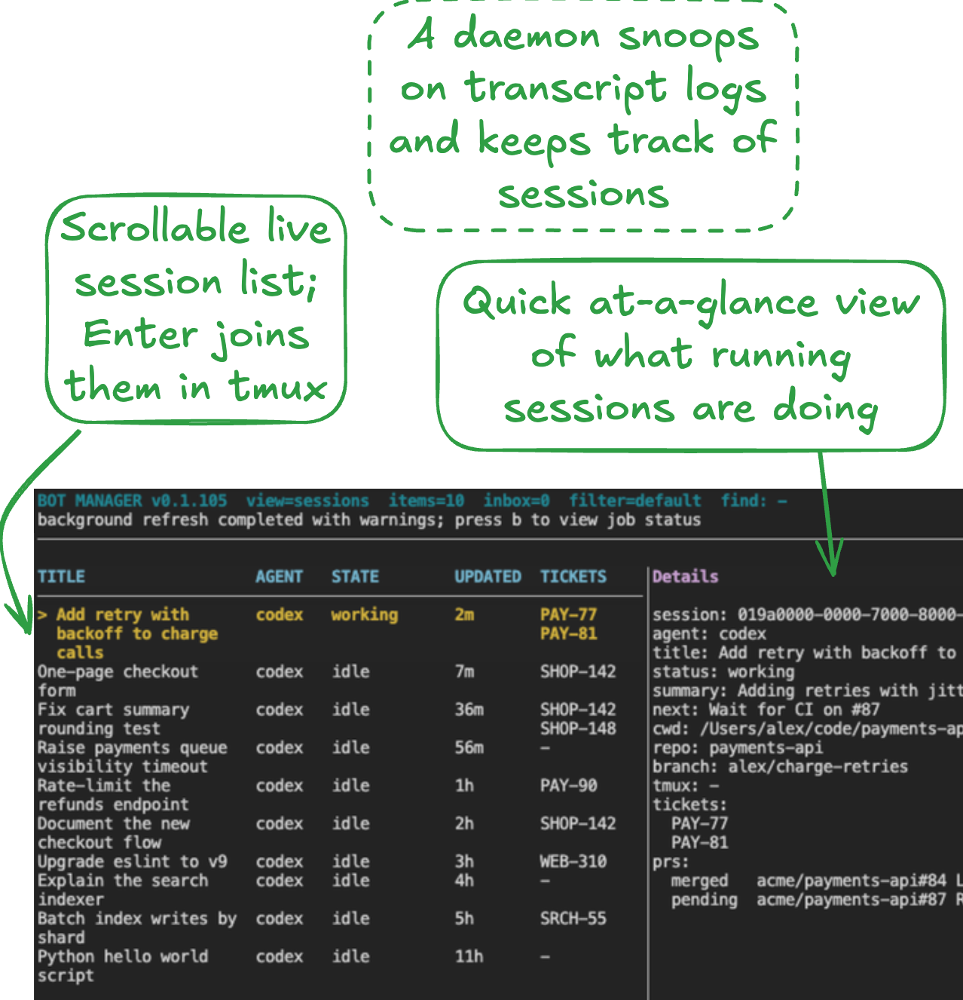
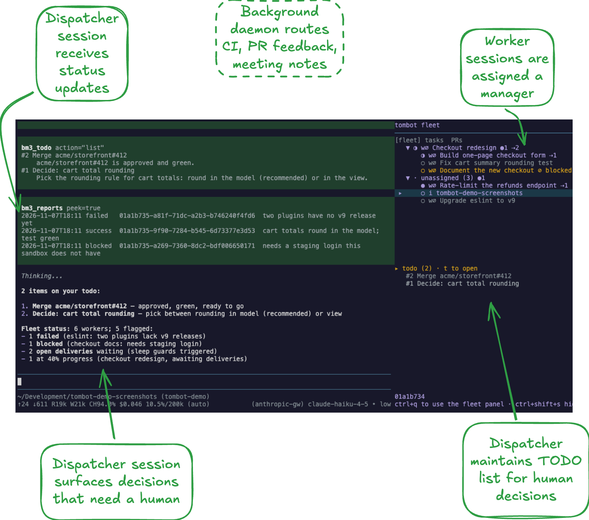
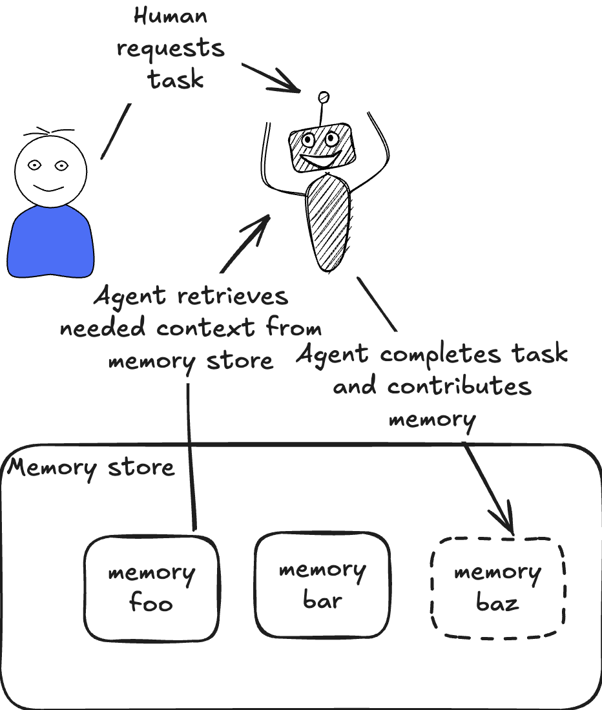
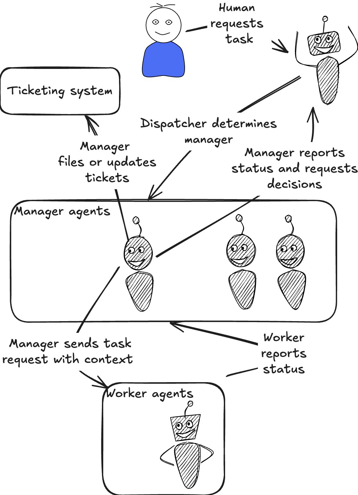

I have, after a period of resistance, adopted a multi-agent setup for my work, and it's difficult to see going back. I've been skeptical of token maxing tools like Gas Town, whose creator admits it was mostly used to build itself[^1]. But models are now good enough to autonomously and productively work for long periods of time. My effort goes towards keeping the fleet on track, and increasing the number of agents doing high quality work.

My work now is more similar to a pre-AI engineering manager than a pre-AI software engineer. There's less technical growth, less in depth understanding of the code. But the scope and volume of what I'm able to build is dramatically greater than it was before.

{/* truncate */}

Rather than pitch yet another agent orchestrator[^1] to you, I'll go through how I landed here, what components of multi-agent orchestration are important, and broader implications for the practice of software engineering.

# The journey to multi-agent

## Stage 1: Sea of iTerm tabs

AI allows me to make progress on several tasks at once, which I started by managing a sea of iTerm windows. This quickly got difficult to manage. Some tasks are fire and forget, others I need to drive myself, but managing tabs by hand didn't give me a way to distinguish them. It was also lossy: accidentally closing a tab means resuming by fishing the session out of Codex (or was it Claude Code?).

Even when keeping tabs running, it was not always trivial to remember what each tab was working on.

## Stage 2: Tmux navigation, tracking session state, naming sessions

My first iteration was a central Tmux directory, which snooped on local harness logs to name sessions, track basic progress, and determine which sessions were active.

I eventually got frustrated. Sessions would do some useful work, ask for a decision, and wait until I paged back to it. I was spending way too much time tabbing through sessions (which I could now easily find, at least), and giving agents some variation of "keep working". It also became very difficult to keep track of the higher level goals I was working towards and understand how the different sessions in play fit together.

## Stage 4: Multi-agent

I solved the problem by throwing AI at it. I arranged sessions in a hierarchical graph, with the root node handling dispatch, receiving progress reports, and nudging inactive agents. Manager nodes keep tickets up to date, handle decisions not worth escalating to root, and ensure worker nodes are following a consistent development process I specify. The root node makes decisions based on my previous guidance where it can, and curates an inbox of decisions that need me.

This also provides a natural on-ramp to self improvement. When an agent does something wrong, it persists a correction to its process, either through changes to node-specific `AGENTS.md` files or by changes to the routing system.

This enabled quick development of a lot of nice-to-have features:
- *Scheduled checks*: I can simply say to root, "check xyz metric twice a day for two weeks", and the check happens without fiddling with crontab entries.
- *Subscription hooks*: I can automatically subscribe to incoming information, whether it be PR reviews, CI builds, or even meeting notes. I now have the experience of meeting with a colleague, making decisions, and when I get back to development my fleet has already ingested AI-generated notes and started work.

Since the dispatcher works by snooping on local transcript logs, I don't _need_ to go through it to investigate something or start a new task. I can simply fire up a standalone pi session, and the dispatcher will recognize a new session has started, assign a manager, and track progress.

# Long lived agents > memory

I used to think the key to self-improving agents was _memory_. In this model, agents are cattle, not pets. They boot up, load necessary context from a pool of memory, do work, and contribute back to the memory pool:

But managing context via memories is _hard_. It's difficult for an agent working on a narrow task to determine what broader context that task informs. The most useful context from a task session is often what the status of the task is, but that information quickly goes stale.

Even given a set of ideal memories, it's difficult to build an effective recall system. Some tasks are one-offs. They require little outside context and don't have much to contribute to a central memory pool. Others interact with other ongoing work or reflect impactful decisions. It's difficult for a recall system to really know which category a session belongs to.

An agent fleet structured as a graph solves this problem much better. A central dispatcher node maintains high-level awareness of what work is happening. I ask for a piece of work, the dispatcher augments with relevant context, and the work happens in the background. The dispatcher receives progress updates, reacts accordingly, and discards them.

# Tension, human code review, and agentic bureaucracy

Working in this way breaks fundamental norms of pre-AI software engineering. The scale of code being produced is too much to ask human collaborators to review. It's natural for someone who reviews PRs themselves to feel resentment at being asked to review a firehose of AI-generated code the author didn't read closely.

I don't disagree. Human code review of multi-agent produced code is untenable. But I don't think human code review is always _necessary_.

For one, AI code review (to my surprise) is _really good_. It does a much better job of catching edge cases and contract changes than a human, especially one that might not be in the weeds of the code they are reviewing.

But we can do better than just AI code review. We can _force the agent to prove the code works_, via an unbounded set of pre-merge, pre-deploy, and post-deploy verification steps.

We had this option before, of course, but there's a limit to how much box checking a human will put up with. An agent, though, will work through nitpicking linters, patiently wait for long canary bake times, and diligently check however long a list of performance and correctness metrics you want to throw at it.

# Change

We're in a time of dramatic change, and while I'm convinced working this way is more _productive_, I don't expect everyone to _like it_. The agent swarm approach to development does not play nice with human-driven development. Organizations will have to choose one, and I think the swarms are simply too productive to beat.

I do have some worry for the practice overall. Increasingly when I talk to my dispatcher session, I get a response that's both satisfying and scary: _nothing needs you right now_.

But becoming a software engineer meant signing up for rapid change, whether we acknowledged it or not. We're in the automation business. I still have confidence that software will remain an interesting and rewarding field. What it looks like, though, is anyone's guess.

[^1]: I'm a bit skeptical of Yegge's recent assertions that his new, unreleased token maxing tool is actually *very good*.

[^1]: The code for this tool belongs to my company, but can be easily open sourced. If you're interested email me at tombedor.dev and I'll follow up with a release.

[^2]: Bot Manager 2 never really got off the ground. It's essentially the same as Bot Manager 3, with a web UI I never ended up using.
