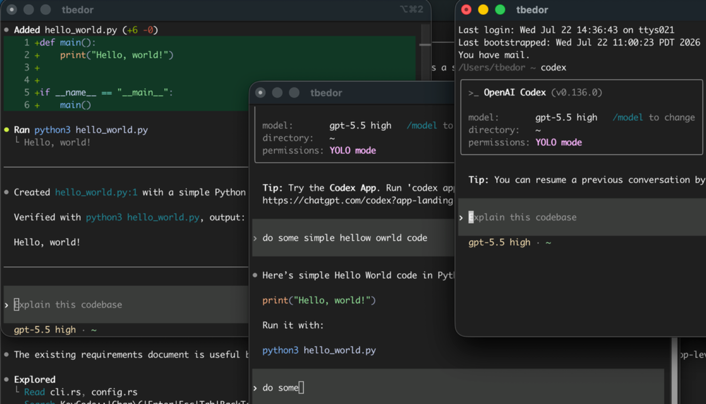
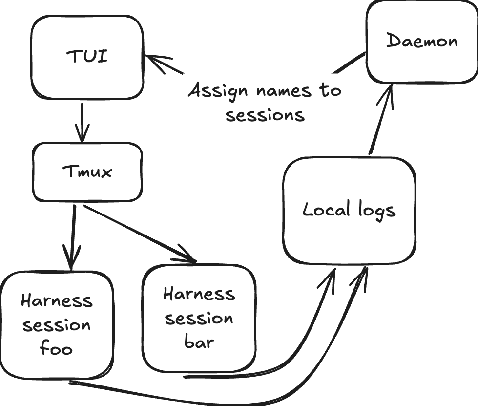
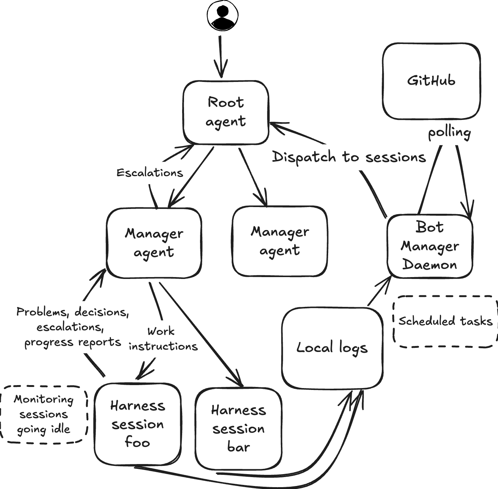

I've adopted a multi-agent setup, and I can't see going back. I've been skeptical of token maxing tools like Gas Town, whose running cost felt inordinate and whose creator admits was mostly used to build itself. On the other hand, models are now good enough to autonomously and productively work for long periods of time. My effort now goes towards keeping the fleet on track, maintaining progress towards high-level goals, and increasing the number of agents doing high-quality work.

Working this way is more similar to a pre-AI engineering manager than a pre-AI software engineer. There's less technical growth and less in-depth understanding of the code. But the scope and volume of what I'm able to build is dramatically greater than it was before.

Rather than pitch yet another agent orchestrator[^1] to you, I'll explain how I landed here, which components of multi-agent orchestration matter, and what this shift means for the practice of software engineering.

{/* truncate */}

# The journey to multi-agent

## Stage 1: Sea of iTerm tabs

AI allows me to make progress on several tasks at once, which I started managing with a sea of iTerm windows. This quickly got difficult to manage. Some tasks are fire-and-forget, while I need to drive others myself. Managing tabs by hand didn't give me a way to distinguish between them. It was also lossy: accidentally closing a tab means resuming by fishing the session out of Codex (or was it Claude Code?).

Even when keeping tabs running, it was not always trivial to remember what each tab was working on.

## Stage 2: Tmux dashboard

I built a central Tmux dashboard for agent sessions. With a dash of search functionality, the problem of losing track of sessions was solved.

The architecture is simple: a daemon snoops on local transcript logs to track which sessions are active and assign names.

I eventually got frustrated. Sessions would do some useful work, ask for a decision, and wait until I tabbed back to them. I was spending way too much time cycling through sessions (which I could now easily find, at least), and giving agents some variation of "keep working." It also became difficult to keep track of the higher-level goals I was working towards and understand how the different sessions in play fit together.

## Stage 3: Agent fleet

It was time for manager agents. I arranged sessions in a hierarchical graph. The root node handles dispatch, receives progress reports, and nudges inactive agents. Manager nodes keep tickets up to date, handle decisions not worth escalating to root, and ensure worker nodes are following a consistent development process. The root node makes decisions based on my previous guidance where it can, and curates an inbox of decisions that need me.

This also provides a natural on-ramp to self-improvement. When an agent does something wrong, it persists a durable correction, either by changing node-specific `AGENTS.md` files or by changing the routing system[^2].

This enabled quick development of nice-to-have features:
- *Scheduled checks*: I can say to root, "check xyz metric twice a day for two weeks," and the check happens without fiddling with crontab entries.
- *Subscription hooks*: I can automatically subscribe to incoming information, whether from PR reviews or CI builds.
- *Meeting notes ingestion*: After I meet with a colleague, my fleet automatically ingests Gemini notes. When I get back to development, my fleet has already ingested AI-generated notes and started work.

Since the dispatcher functions by snooping on local transcript logs, I don't _need_ to go through it to investigate something or start a new task. I can simply fire up a standalone pi session, and the dispatcher will recognize that a new session has started, assign a manager, and track progress.

# Long-lived agents > memory

I used to think the key to self-improving agents was _memory_. In this model, agents are cattle, not pets. They boot up, load necessary context from a pool of memory, do work, and contribute back to the memory pool:

But managing context via memories is _hard_. Agents working on a narrow task lack the necessary information to determine what broader context that task informs. The most useful context from a task session is often what the status of the task is, but that information quickly goes stale.

Building a recall system requires a delicate balancing act. Small, self-contained tasks require little outside context and don't have much to contribute to a central memory pool. Recall for these sessions slows the agent down and bloats context. On the other hand, too little recall on more substantial work leads to clashes with work from other agents and dropped decisions.

An agent fleet arranged in a graph solves this problem much better. A central dispatcher node maintains high-level awareness of what work is happening. I ask for a piece of work, the dispatcher augments the request with relevant context, and the work happens in the background. The dispatcher receives progress updates, reacts accordingly, and discards them.

# Tension, human code review, and agentic bureaucracy

Working via an agent fleet breaks fundamental norms of pre-AI software engineering. The scale of code being produced is too much to ask human collaborators to review. Teammates who review PRs without AI can naturally feel resentment at being asked to review a firehose of AI-generated code that the author didn't read closely.

I don't disagree. Human review of code produced by multiple agents is untenable. But I don't think human code review is always _necessary_.

For one, AI code review (to my surprise) is _really good_. It does a much better job of catching edge cases and contract changes than a human, especially when the human reviewer is busy on other projects and is not in the weeds of the code they are reviewing[^3].

But we can do better than just AI code review. We can _force the agent to prove the code works_, via what I call _agentic bureaucracy_: an unbounded set of pre-merge, pre-deploy, and post-deploy verification steps.

We've always had quality assurance processes outside of code review. But while there's a limit to how much box checking a human will put up with, an agent will put up with nitpicking linters, patiently wait for long canary bake times, and diligently check as many performance and correctness metrics as you want.

# Change

We're in a time of dramatic change, and while I'm convinced working this way is more _productive_, I don't expect everyone to _like it_. The agent swarm approach to development does not play nice with human-driven development. Organizations will have to choose one, and I think the swarms are simply too productive to beat.

I do have some worry for the practice of software engineering overall. Increasingly, when I talk to my dispatcher session, I get a response that's both satisfying and scary: _nothing needs you right now_.

But becoming a software engineer meant signing up for rapid change, whether we acknowledged it or not. We're in the automation business. I still have confidence that software will remain an interesting and rewarding field. I just don't know how many seats there will be, or what the work will look like.

[^1]: The code for this tool belongs to my company, but can easily be released as open source. If you're interested, email me at hello@tombedor.dev and I'll follow up with a release.
[^2]: Not without some nudging. Agents have an annoying habit of saying, "You're right. I won't do that again!" without actually preserving the directive in code.
[^3]: The platonic ideal is for at least one or two teammates to have in-depth, fresh context on the code being changed. I actually experienced this very rarely!
